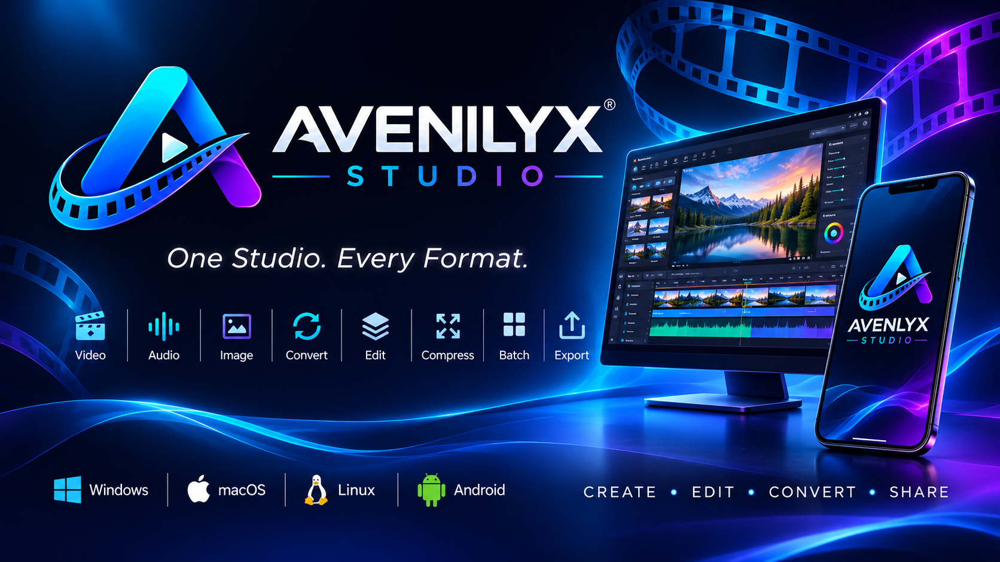

# AVENLYX Studio (FORMATÇI) — Profesyonel Medya Düzenleme ve Dönüştürme Stüdyosu

<p align="center">
  
</p>

**AVENLYX Studio (FORMATÇI)**, modern C++20 ve Qt 6 Widgets arayüzü ile güçlendirilmiş masaüstü stüdyosu ve Kotlin, Jetpack Compose ile AndroidX Media3 ile güçlendirilmiş %100 çevrimdışı mobil stüdyosuyla; resim, video ve ses dosyalarını çok kanallı zaman çizelgesi (Timeline), canlı önizleme, efekt/ses mikseri ve toplu dönüştürme yetenekleriyle işleyen profesyonel bir medya çözümüdür.

---

## 📁 Proje Klasör Mimarisi (Genel Standart)

Bu proje ve sonraki tüm uygulamalar için geçerli olan standart hiyerarşi:

```
FORMATCI/
│
├── desktop/                  # Masaüstü uygulaması kaynak kodları ve derleme ortamı
│   ├── src/                  # C++20 & Qt 6 kaynak kodları (.cpp, .h)
│   ├── build/                # CMake & Ninja derleme çıktıları
│   ├── CMakeLists.txt        # CMake yapılandırma dosyası
│   └── baslat.bat            # Geliştirme/derleme dizininden başlatıcı
│
├── mobile/                   # AVENLYX Studio — Android medya stüdyosu (Kotlin, Compose, Media3)
│   ├── app/                  # Uygulama kaynak kodları, res ve JUnit birim testleri
│   ├── gradle/               # Gradle 8.11.1 wrapper ve libs.versions.toml
│   ├── README.md             # Mobil mimari ve derleme rehberi
│   ├── SUPPORTED_FORMATS.md  # Motor ve cihaz bazlı gerçek format matrisi
│   └── KNOWN_LIMITATIONS.md  # Bilinen platform ve Media3 sınırlamaları
│
├── dist/                     # Nihai dağıtım ve çalıştırılabilir paketler
│   ├── desktop/              # Bağımsız masaüstü dağıtımı (AvenlyxStudio.exe + Qt/MinGW DLL'leri + baslat.bat)
│   └── mobile/               # Mobil APK paketleri (AvenlyxStudio-debug.apk, AvenlyxStudio.apk)
│
├── README.md                 # Proje ana dokümantasyonu
├── GEMINI.md                 # Çalışma alanı kural ve kılavuzları
└── AGENTS.md                 # Otomasyon ve ajan yönergeleri
```

---

## 🚀 Hızlı Başlangıç (Uygulamayı Çalıştırma)

Masaüstü uygulaması ve tüm çalışma zamanı bağımlılıkları `dist/desktop/` klasöründe yer almaktadır. Uygulamayı başlatmak için:

```cmd
dist\desktop\baslat.bat
```
veya doğrudan `dist\desktop\AvenlyxStudio.exe` dosyasına çift tıklayabilirsiniz.

---

## 🎨 Temel Yetenekler ve Özellikler

### 1. Çok Formatlı Evrensel Dönüştürücü
- **Resimler:** PNG, JPG/JPEG, WebP, AVIF, HEIC, BMP, TIFF, GIF, ICO, TGA, PPM, PDF (vektör/doküman çıktısı).
- **Videolar:** MP4 (H.264), MKV, WebM (VP9), MOV, AVI, M4V, FLV, WMV, 3GP, MPEG-TS, MPG, OGV, Animasyonlu GIF.
- **Sesler:** MP3, WAV (Kayıpsız), FLAC (Kayıpsız), AAC, M4A, OGG, OPUS, WMA, AIFF, AC3, MKA.
- **Çoklu Ses Kanalı Desteği:** Videolardaki birden çok dili veya ses parçasını tespit edip seçebilme (`-map`).

### 2. Canlı Önizleme Monitörü (`PreviewWidget`)
- Stüdyo görünümü siyah tuval üzerinde en-boy oranını koruyarak kare görüntüleme.
- Oynat/Duraklat, Başa Sar, -1sn, +1sn adım kontrolleri.
- Giriş (`[I]`) ve Çıkış (`[O]`) kesme noktaları işaretleme.
- Zaman kodu sayacı (`HH:MM:SS.cc`).

### 3. Çok Kanallı Zaman Çizelgesi (`TimelineWidget`)
- **Video ve Katman Kanalları:** `V1 - Video 1`, `V2 - Görsel / Katman` (sınırsız kanal ekleme).
- **Ses Kanalları:** `A1 - Ses 1`, `A2 - Ses 2` (Mute `[M]` ve Solo `[S]` düğmeleri).
- **Klip Düzenleme:**
  - Sürükle-bırak ile doğrudan kanala medya ekleme.
  - Klip sol/sağ kenarlarından tutarak kırpma (Trim).
  - Playhead konumundan klip bölme (Split).
  - Klip içi ses dalga formu (Waveform) görselleştirme.
- **Zaman Çizelgesini Dışa Aktar (Render):**
  - FFmpeg `-filter_complex` motoru ile katmanlı video overlay, alfa şeffaflığı ve çoklu ses miksajı (`amix`, `afade`, `adelay`).

### 4. Denetleyici ve Efekt / Ses Mikseri
- **Görüntü Ayarları:** Parlaklık, Kontrast, Doygunluk, 90°/180°/270° Döndürme, Yatay/Dikey Aynalama, Siyah-Beyaz ve Sepya filtreleri.
- **Ses Mikseri:** %0 - %200 ses seviyesi, Fade-In ve Fade-Out süreleri.
- **Codec & Çıktı:** Özel genişlik/yükseklik, FPS, kalite yüzdesi, ses bitrate ve örnekleme hızı ayarları.

---

## 🛠️ Masaüstü Uygulamasını Kaynak Koddan Derleme

Geliştiriciler için `desktop/` altında CMake ve MinGW ile derleme adımları:

```powershell
cd desktop

# CMake ile derleme dizini yapılandırma
cmake -S . -B build -G Ninja -DCMAKE_BUILD_TYPE=Release -DCMAKE_PREFIX_PATH="C:\Qt\6.8.0\mingw_64"

# Paralel derleme
cmake --build build --parallel

# Çalışma zamanı bağımlılıklarını yerleştirme (windeployqt)
C:\Qt\6.8.0\mingw_64\bin\windeployqt.exe --release build\AvenlyxStudio.exe
```

Nihai derleme çıktısı `dist/desktop/` dizinine kopyalanarak dağıtıma hazır hale getirilir.

---

## 📱 Mobil Uygulama: AVENLYX Studio (Android)

**AVENLYX Studio**, `mobile/` dizininde Kotlin `2.0.21`, Jetpack Compose (Material 3) ve AndroidX Media3 `1.5.1` teknolojileriyle geliştirilmiş, **%100 çevrimdışı** (`INTERNET` izni olmadan) çalışan bir mobil video, ses ve resim stüdyosudur.

### Öne Çıkan Mobil Özellikler
- **Gerçek Cihaz İçi Motorlar (Simülasyon Yok):**
  - **Video & Slayt (`Media3Engine`):** Media3 `ExoPlayer` canlı önizleme ve `Transformer` ile MP4 (H.264/HEVC/AV1), cihaz destekliyorsa 2 aşamalı WebM (VP9 + Opus), video kırpma, birleştirme, döndürme/çevirme, parlaklık/kontrast/doygunluk, Siyah-Beyaz/Sepya, hız (`0.25x–4x`), metin filigranı, harici ses ekleme (`AudioFitMode`) ve fotoğraflardan MP4 slayt videosu.
  - **Ses (`AndroidPlatformEngine`):** `MediaExtractor` + `MediaCodec` + `MediaMuxer` + yerleşik RIFF/WAV yazıcısı ile tüm cihazlarda garantili **WAV (PCM)** ve **M4A (AAC)** (cihazda encoder varsa OPUS/FLAC), gerçek dalga formu (`waveformPeaks`), kesme, fade-in/out, birleştirme ve iki sesi miksleme.
  - **Resim (`ImageEngine`):** `ImageDecoder`/`BitmapFactory` (`inSampleSize` RAM korumalı), `Canvas`/`Matrix`, EXIF okuma/silme, şeffaf PNG -> JPG arka plan rengi doldurma, filigran ve toplu **JPG, PNG, WebP, BMP** dönüştürme/sıkıştırma.
- **Uyarlanabilir Studio Arayüzü & Güvenilirlik:**
  - Telefonlar için tek elle erişilebilir alt gezinme çubuğu (`NavigationBar`), tablet/geniş ekranlar için `NavigationRail` + 2 sütunlu düzen.
  - Basit Mod / Gelişmiş Ayarlar geçişi, Açık/Koyu/Sistem teması, Undo/Redo destekli zaman çizelgesi projesi (`StudioDatabase` SQLite kalıcılığı ve kesintiye uğrayan iş kurtarma).
  - Android 14/15 uyumlu `foregroundServiceType="mediaProcessing"` ön plan servisi, `StatFs` boş alan kontrolü, SAF/PhotoPicker ve atomik `MediaStore` kaydı.
  - Gerçek cihaz encoder taraması (`EngineCapabilityRegistry`) ve 14 senaryolu Türkçe hata çözüm rehberi (`StudioErrorMapper`).

### Mobil APK Paketleri ve Derleme
- Hazır kurulum paketleri (`minSdk 26` / Android 8.0+, `targetSdk 35` / Android 15):
  - `dist/mobile/AvenlyxStudio-debug.apk`
  - `dist/mobile/AvenlyxStudio.apk`
- Kaynak koddan test ve derleme:
  ```powershell
  cd mobile
  .\gradlew.bat testDebugUnitTest assembleDebug
  ```
- Ayrıntılı mobil dokümanlar: [mobile/README.md](mobile/README.md), [mobile/SUPPORTED_FORMATS.md](mobile/SUPPORTED_FORMATS.md), [mobile/KNOWN_LIMITATIONS.md](mobile/KNOWN_LIMITATIONS.md), [mobile/CHANGELOG_DEV.md](mobile/CHANGELOG_DEV.md).

